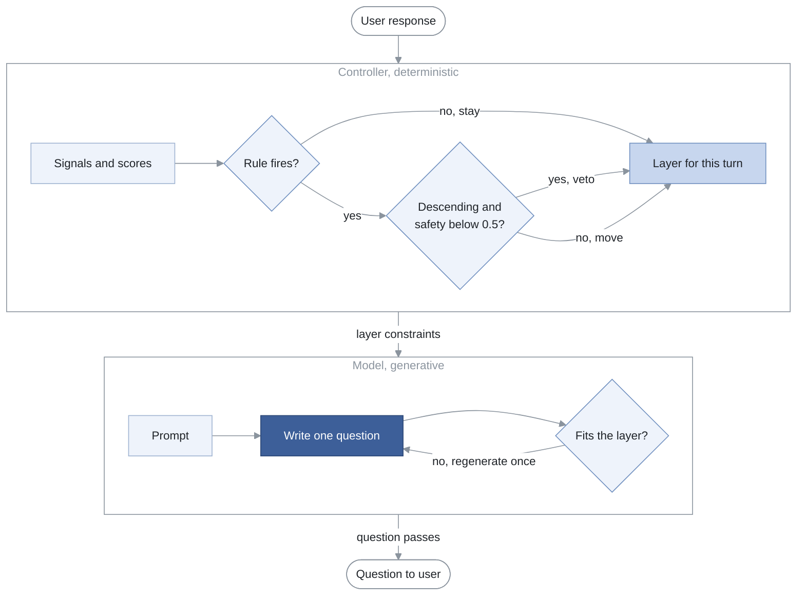

<!-- register: technical. Constants: ldtmp.config.json -->

# LDTMP: A Layered Depth Tension Modulation Protocol for Pacing Emotional Depth in AI-Led Conversations

**Alexander Milovidov**
Independent researcher

*Technical report, Specification 1.0, 2026-10-23*
*Copyright (c) 2026 Alexander Milovidov. Licensed under CC BY 4.0.*

---

## Abstract

AI interviewers built on large language models can hold fluent conversations, yet they have no principled way to decide how personal a conversation should become or when. When the model itself is left to judge a person's readiness for deeper questions, it tends to agree with whatever direction the conversation is already taking. This report specifies LDTMP, a protocol that moves that decision out of the model. LDTMP defines six conversation layers that rise from rapport to the most personal material and then descend to a forward-looking close. Deterministic rules move a session between layers using behavioral signals computed from each response: length, latency, vocabulary diversity, emotional expression and trends across the session. A safety gate can veto any move toward greater depth. The model writes one question at a time inside constraints set by the current layer. The report gives the complete rule set and its constants, proves a bound on when the safety gate can bind, and presents three worked examples that serve as test vectors. It also documents three defects found in the first production implementation, together with the conformance tests that catch them. LDTMP has not been empirically evaluated, and its thresholds are hand-tuned starting values.

**Keywords:** conversational agents, large language models, conversation design, self-disclosure, engagement signals, AI interviewers

---

## 1. Introduction

An interview has a shape. Skilled interviewers open with easy questions, build rapport, move toward the material that matters, and close in a way that leaves the other person steady. Journalists, oral historians, coaches and user researchers all learn some version of this arc. They also learn to read when the other person is not ready to go further, and to step back.

Language-model interviewers reproduce the surface of this skill without its structure. A model prompted to "go deeper when appropriate" decides depth implicitly, one turn at a time, with no persistent state and no record of why it chose. Two failures follow from that design. A model can push a disengaged person toward heavy topics because the prompt invited depth, and it can stay at small talk for an entire session because nothing required it to advance. Neither failure is visible after the fact, because the decision was never made explicitly.

LDTMP addresses this with a separation of responsibilities. A deterministic controller holds the conversation's position in a fixed six-layer arc and moves it only when measured signals satisfy explicit rules. The language model receives the current layer's constraints with every request and writes within them. The protocol was first built for a voice-first app that interviews people about their memories and turns those conversations into written stories, and it ran in production in that app.

This report makes four contributions:

1. A complete, implementable specification of the six layers, their generation constraints, the signal formulas, the transition rules and the safety gate, with every constant published in machine-readable form.
2. A short analysis of the protocol's properties. It proves that the safety gate binds in exactly one situation when signals are derived as specified.
3. Three worked examples, computed from the formulas, that implementations can use as conformance tests.
4. A record of three defects from the first production implementation and the tests that catch them.

### 1.1 Scope and non-clinical status

LDTMP is a conversation-design protocol. Nobody has validated it as therapy or as a clinical intervention, and it makes no claim to be either. Some layer names borrow vocabulary from narrative practice, and several of the cited sources come from counseling research. That borrowing describes pacing only.

The safety score in this specification is a pacing control. It keeps the system from pushing a disengaged person toward heavier topics. It does not detect crisis, self-harm risk or distress, and an implementation must not present it as doing so. Any product that may meet people in distress needs a separate, purpose-built escalation path.

### 1.2 Conventions

The key words MUST, MUST NOT, SHOULD and MAY follow RFC 2119. Every numeric constant in this report also appears in [`ldtmp.config.json`](ldtmp.config.json), and an agent implementing the protocol should load every number from that file. Times are in milliseconds unless a unit is stated. Scores are real numbers clamped to the closed interval [0, 1].

## 2. Background and related work

### 2.1 Graduated self-disclosure

Social penetration theory describes relationships as deepening through a gradual increase in the breadth and depth of what people disclose to each other (Altman & Taylor, 1973). Disclosure proceeds in layers, from public facts toward private values and feelings, and moving too fast tends to stall it. Aron et al. (1997) turned the idea into a procedure. Pairs of strangers who answered a sequence of questions that escalated in personal depth over 45 minutes reported greater closeness than pairs who held small talk for the same time. LDTMP adopts the same premise of ordered, escalating depth, and it adds explicit conditions for advancing and for retreating.

### 2.2 Pacing in narrative and motivational practice

Narrative practice treats the stories people tell about their experiences as material to explore and re-author, and it moves from the account of events toward their meaning (White & Epston, 1990). Motivational interviewing emphasizes following the person's lead, evoking their own perspective and adjusting pace to their readiness (Miller & Rollnick, 2013). LDTMP borrows the pacing discipline from both traditions. Their clinical aims are out of scope. Its descent from the peak through a relief layer to a forward-looking close reflects the shared view that a conversation which reaches difficult material should not end there.

### 2.3 Behavioral signals of engagement

The signals LDTMP measures have established links to conversational state. Speakers use fillers such as "uh" and "um" to signal anticipated delays in speech planning (Clark & Fox Tree, 2002). Listeners read response latency and filled pauses as cues to how confident a speaker is in an answer (Brennan & Williams, 1995). The degree to which participants match each other's function-word style predicts cohesiveness and performance in small groups (Gonzales et al., 2010). Turn-taking follows a systematic organization that makes timing between turns meaningful (Sacks et al., 1974). Emotional state can be described along valence and arousal dimensions (Russell, 1980).

LDTMP turns these ideas into simple heuristics such as word counts, latency bands, unique-word ratios and emotion-marker counts. None of the cited studies validated those heuristics, and Section 6.2 treats the gap as a limitation.

### 2.4 Agreement bias in language models

Language models trained with human feedback show sycophancy, a tendency to tell users what they appear to want to hear. Human preference judgments themselves favor such responses some of the time (Sharma et al., 2023). The bias matters for depth control. A model asked whether a person is ready for a more personal question receives a prompt that already frames depth as the goal, and agreement is the likeliest answer. LDTMP removes that judgment from the model entirely. This is its central design choice.

## 3. The protocol

### 3.1 Design principles

**P1. Deterministic layer decisions.** The layer decision is a pure function of measured signals and session state. It runs before generation, and its output becomes part of the prompt.

**P2. Layers constrain by exclusion.** Each layer lists topics to avoid, a word range for the question and an emotional intensity. Those boundaries leave the model free to respond to what the person said.

**P3. Asymmetric transitions.** Moving deeper requires time in the current layer, sustained engagement and evidence of depth, and it can only advance one layer at a time. Moving back toward a lighter layer requires one strong disengagement signal and can jump any number of layers.

**P4. Every decision carries its reasons.** The layer decision returns the inputs it used, the rule that fired and a confidence value. That record lets a person audit a session after the fact, and it gives an evaluation harness something to assert against.

### 3.2 The six layers

The layers form an arc that rises and comes back down. The sequence order in Table 1 is the order of progression. The intensity column gives the emotional weight of questions in each layer, and it falls again after the peak.

**Table 1.** The six conversation layers in order of progression, with the emotional intensity of each.

| # | Layer | Intensity | Purpose |
|---|---|---|---|
| 0 | `ICEBREAKER` | light | Build rapport and lower the cost of answering. |
| 1 | `SURFACE` | light | Open the topic with broad, easy questions. |
| 2 | `INITIAL_DESCENT` | moderate | Ask what the experience meant and how it felt. |
| 3 | `EMOTIONAL_SATURATION` | deep | Stay present with the strongest material the person chooses to share. |
| 4 | `RELIEF_ARC` | moderate | Turn toward perspective, strength and what was learned. |
| 5 | `REENTRY` | light | Close the conversation and look forward. |

The "tension modulation" in the protocol's name refers to this shape. Tension rises through layers 0 to 3 and resolves through layers 4 and 5. The protocol treats the resolution as mandatory. A conversation that reaches layer 3 and stops there leaves the person at the heaviest point of the session.

Figure 1 shows the arc as a state machine. Forward moves advance one layer at a time, and the safety gate covers the three moves before the peak. Each retreat rule in Table 4 steps back one layer, and the structural rule in Section 3.6.2 also permits longer backward jumps.

```mermaid
%%{init: {"theme": "base", "themeVariables": {"fontFamily": "Helvetica Neue, Helvetica, Arial, sans-serif", "fontSize": "14px", "lineColor": "#7d8590", "primaryTextColor": "#1f2328"}, "flowchart": {"curve": "basis", "nodeSpacing": 28, "rankSpacing": 46}}}%%
flowchart LR
    I([Icebreaker]):::light
    S([Surface]):::light
    D([Initial descent]):::moderate
    E([Emotional saturation]):::deep
    R([Relief arc]):::moderate
    N([Reentry]):::light

    I ==> S ==> D ==> E
    E --> R --> N

    S -.-> I
    D -.-> S
    E -.-> D
    R -.-> E
    N -.-> R

    classDef light fill:#eef3fb,stroke:#9fb3d1,stroke-width:1px,color:#1f2328
    classDef moderate fill:#c7d6ee,stroke:#6f8fbf,stroke-width:1px,color:#1f2328
    classDef deep fill:#3d5f99,stroke:#2b4775,stroke-width:1px,color:#ffffff
    linkStyle 0,1,2 stroke:#3d5f99,stroke-width:2.5px
    linkStyle 3,4 stroke:#7d8590,stroke-width:1.5px
    linkStyle 5,6,7,8,9 stroke:#8b949e,stroke-width:1.2px
```



**Figure 1.** The six layers as a state machine. Shading encodes emotional intensity from light to deep. Thick arrows are forward moves that the safety gate covers, thin arrows are ungated forward moves, and dotted arrows are retreats.

### 3.3 Generation constraints per layer

The orchestrator passes the constraints in Table 2 to the model with every generation request. The word range applies to the generated question.

**Table 2.** Generation constraints that the orchestrator passes to the model for each layer.

| Layer | Question words | Recommended topics | Topics to avoid | Tone |
|---|---|---|---|---|
| `ICEBREAKER` | 8 to 20 | the current moment, simple facts, light preferences, recent activities | trauma, loss, deep relationships, existential questions, heavy emotions, vulnerability | A warm greeting and one natural question, like catching up with a friend. |
| `SURFACE` | 10 to 25 | daily life, hobbies, interests, work overview, family basics, recent experiences | trauma, loss, deep fears, existential crisis, intense emotions | React warmly to the answer, then ask one curious follow-up. |
| `INITIAL_DESCENT` | 12 to 20 | meaningful relationships, values, life choices, challenges faced, growth moments | deep trauma, unresolved grief, existential dread, severe loss | Thoughtful and concise. One meaningful question. |
| `EMOTIONAL_SATURATION` | 18 to 28 | deep emotions, fears, regrets, turning points, inner conflicts | topics that require professional help | Deeply attentive. One question. Hold space and do not interrogate. |
| `RELIEF_ARC` | 12 to 20 | resilience, lessons learned, strength discovered, perspective gained | reopening fresh wounds, minimizing pain, forced positivity | Supportive and balanced. Acknowledge the difficulty without minimizing it. |
| `REENTRY` | 10 to 18 | future outlook, next steps, integration, grounding | deep emotional topics, unresolved issues, heavy subjects | Warm and grounding. One forward-looking question. |

Every layer shares these generation rules. The model MUST ask exactly one question. The question MUST be open-ended and SHOULD build on a specific detail from the person's last answer. The model MUST NOT use clinical or therapeutic vocabulary, and it MUST NOT ask again about an emotion the person has already named.

An implementation SHOULD validate each generated question against its layer. Checking word count and matching keywords against the avoid list is enough for a first version, and a failed check triggers one regeneration.

### 3.4 Signals

LDTMP reads three kinds of evidence from each user turn. A text-only implementation can compute all of them. A voice implementation can add prosody, though no rule in this specification depends on it.

#### 3.4.1 Per-response measurements

For each user response the implementation records the word count, the latency in seconds between the end of the question and the start of the answer, the number of unique words, and a count of emotional statements. An emotional statement is a sentence that expresses a feeling, fear, aspiration or value. An LLM extraction pass can produce that count in any language, and a keyword list is an acceptable fallback. The implementation keeps a rolling history of these measurements for the session.

#### 3.4.2 Engagement score

The engagement score is a composite over the rolling history.

```
score = 0.2                                       # base
      + length_points(avg_words)                  # 0.30 if >= 50, 0.20 if >= 30, 0.10 if >= 15, else 0
      + latency_points(avg_latency_s)             # 0.20 if <= 5, 0.15 if <= 15, 0.10 if <= 30, else 0
      + 0.2 * min(avg_unique_words / 20, 1)       # vocabulary diversity
      + 0.1 * min(avg_emotional_statements / 3, 1)
      - 0.20 if decreasing_length
      - 0.15 if increasing_latency
      - 0.40 if straight_line_responding
score = clamp(score, 0, 1)
```

The three trend flags need at least four responses in the history. Before that point they are false.

- `decreasing_length`: the mean word count of the second half of the history is below 0.7 times the mean of the first half.
- `increasing_latency`: the mean latency of the second half exceeds 1.5 times the mean of the first half.
- `straight_line_responding`: each of the last three responses has 5 words or fewer.

#### 3.4.3 Engagement level

The engagement level is an ordinal scale (Table 3). Implementations MUST compare levels by rank and MUST NOT compare their string labels (see Section 6.1).

**Table 3.** Engagement levels with their ordinal ranks and assignment conditions.

| Rank | Level | Assigned when |
|---|---|---|
| 0 | `DISENGAGED` | `straight_line_responding` is true, or score ≤ 0.2 |
| 1 | `SHOWING_FATIGUE` | `decreasing_length` and `increasing_latency` are both true, or 0.2 < score ≤ 0.4 |
| 2 | `MODERATE` | 0.4 < score ≤ 0.6 |
| 3 | `ENGAGED` | 0.6 < score ≤ 0.8 |
| 4 | `HIGHLY_ENGAGED` | score > 0.8 |

The pattern overrides in the first two rows take precedence over the score bands, and the implementation checks them in the order shown.

#### 3.4.4 Response quality and topic depth

These two signals come from the latest response alone.

**Response quality** is `minimal` below 10 words, `moderate` from 10 to 29 words and `detailed` at 30 words or more.

**Topic depth** is `deep` when the response has more than 40 words and contains at least one emotional statement. It is `moderate` when the response has more than 20 words or contains an emotional statement. It is `shallow` otherwise. The flow rules use a numeric depth score, with `shallow = 0.2`, `moderate = 0.5` and `deep = 0.8`.

#### 3.4.5 Emotional expression

Emotional expression scores how much feeling the latest response shows on its surface. It is a sum of capped components.

```
expression = min(0.10 * emotion_marker_words, 0.50)       # words such as "nervous", "grateful", "miss"
           + min(0.15 * emotional_stage_directions, 0.30) # transcript cues such as [laughs], [voice breaking]
           + 0.10 if the response contains an ellipsis
           + min(0.05 * exclamation_marks, 0.15)
expression = min(expression, 1)
```

The marker list is language-specific, and implementations SHOULD supply one per supported language. An implementation MAY replace this component with a model-scored value in [0, 1].

#### 3.4.6 Rhythm and the intervention flag

Conversations tend to lose energy in cycles of a few minutes. The implementation tracks minutes since the last intervention, where an intervention is any deliberate change of approach such as a topic shift, a lighter question or a short reflection. A **natural cycle point** occurs at 3 minutes and a **fatigue cycle point** at 6 minutes.

The `should_intervene` flag is true when any of these holds:

- `straight_line_responding` is true
- the engagement score is below 0.4
- `decreasing_length` and `increasing_latency` are both true
- the session has reached a fatigue cycle point
- the session has reached a natural cycle point and the engagement score is below 0.6

### 3.5 Readiness and safety scores

Two derived scores feed the safety gate.

**Emotional readiness.**

```
readiness = 0.4 * engagement_score
          + {detailed: 0.2, moderate: 0.1, minimal: 0}[response_quality]
          + 0.2 * emotional_expression        # Section 3.4.5
          + {deep: 0.2, moderate: 0.1, shallow: 0}[topic_depth]
readiness = clamp(readiness, 0, 1)
```

**Safety.**

```
safety = 1.0
       - 0.4 if level == DISENGAGED
       - 0.2 if level == SHOWING_FATIGUE
       - 0.3 if straight_line_responding
       - 0.2 if fatigue_trend               # decreasing_length AND increasing_latency
       - 0.2 if readiness < 0.4
       - 0.3 if should_intervene
       + 0.2 if level == HIGHLY_ENGAGED
safety = clamp(safety, 0, 1)
```

The safety threshold is 0.5. Implementations MAY make it configurable.

### 3.6 The layer decision

The orchestrator calls the layer decision once per user turn, after it has computed the signals and before it builds the generation prompt.

Figure 2 traces one turn through the protocol. The controller settles the layer before the model writes anything, and the model's output is checked against that layer before the person sees it.



**Figure 2.** One turn of the protocol. The deterministic controller settles the layer, and the model then writes and validates a question inside that layer's constraints.

#### 3.6.1 Session state

```
{
  "current_layer": "ICEBREAKER",
  "exchange_count": 0,        // decisions made so far in this session
  "layer_entered_at": <time>, // reset on every transition
  "session_started_at": <time>
}
```

Every session starts in `ICEBREAKER`.

#### 3.6.2 Transition rules

The controller evaluates the rules for the current layer in the order listed in Table 4, and the first match wins. If none match, the session stays in its current layer. In the table, `t` is the time spent in the current layer, `E` is the engagement level compared by rank, `Q` is response quality and `D` is the numeric depth score.

**Table 4.** Transition rules for each layer, in evaluation order, with the confidence each rule reports.

| From | Rule | To | Confidence |
|---|---|---|---|
| `ICEBREAKER` | `exchange_count ≥ 2` (exchange cap) | `SURFACE` | 1.00 |
| `ICEBREAKER` | `E = HIGHLY_ENGAGED` and `Q = detailed` (fast track) | `SURFACE` | 0.95 |
| `ICEBREAKER` | `exchange_count ≥ 1` and `E ≥ MODERATE` | `SURFACE` | 0.85 |
| `ICEBREAKER` | no match: stay | | 0.80 |
| `SURFACE` | `t > 60 s` and `E ≥ MODERATE` and `D ≥ 0.3` | `INITIAL_DESCENT` | 0.80 |
| `SURFACE` | `E = DISENGAGED` and `Q = minimal` | `ICEBREAKER` | 0.70 |
| `SURFACE` | no match: stay | | 0.75 |
| `INITIAL_DESCENT` | `t > 120 s` and `E = HIGHLY_ENGAGED` and `D ≥ 0.6` | `EMOTIONAL_SATURATION` | 0.85 |
| `INITIAL_DESCENT` | `E = DISENGAGED` and `Q = minimal` | `SURFACE` | 0.75 |
| `INITIAL_DESCENT` | no match: stay | | 0.80 |
| `EMOTIONAL_SATURATION` | `t > 180 s` and `E = HIGHLY_ENGAGED` and `D ≥ 0.8` | `RELIEF_ARC` | 0.90 |
| `EMOTIONAL_SATURATION` | `E ≤ MODERATE` and (`Q = minimal` or `D < 0.3`) | `INITIAL_DESCENT` | 0.80 |
| `EMOTIONAL_SATURATION` | no match: stay | | 0.85 |
| `RELIEF_ARC` | `t > 60 s` and `E ≥ MODERATE` | `REENTRY` | 0.85 |
| `RELIEF_ARC` | `E = DISENGAGED` and `Q = minimal` | `EMOTIONAL_SATURATION` | 0.75 |
| `RELIEF_ARC` | no match: stay | | 0.80 |
| `REENTRY` | `E = DISENGAGED` and `Q = minimal` | `RELIEF_ARC` | 0.80 |
| `REENTRY` | no match: stay | | 0.95 |

Two structural rules apply on top of the table. A forward transition MUST advance exactly one layer, and the fast track from `ICEBREAKER` to `SURFACE` counts as one layer. A backward transition MAY move to any earlier layer.

#### 3.6.3 The safety gate

The safety gate applies to every **descending** transition. A descending transition is any forward move before the peak, so its target is `SURFACE`, `INITIAL_DESCENT` or `EMOTIONAL_SATURATION`. The move into `SURFACE` keeps the same light intensity, and the gate covers it because leaving the icebreaker before the person has warmed up at all wastes the rapport phase. When the safety score is below the threshold, the gate vetoes the transition, the session stays in its current layer, and the decision reports confidence 0.90.

The gate MUST NOT apply to moves into `RELIEF_ARC` or `REENTRY`. Those moves come after the peak and reduce intensity, and blocking them would hold a struggling person at the heaviest point of the conversation. The gate also never applies to backward transitions.

The gate overrides the `ICEBREAKER` exchange cap. A person who is disengaged at the cap stays in `ICEBREAKER`, and the orchestrator should treat that as a signal to change approach or offer to end the session.

#### 3.6.4 Decision output

```json
{
  "target_layer": "SURFACE",
  "should_transition": true,
  "confidence": 0.95,
  "reasoning": ["..."],
  "signals": {
    "engagement_score": 0.9333,
    "emotional_readiness": 0.8733,
    "safety_score": 1.0
  },
  "metadata": {
    "previous_layer": "ICEBREAKER",
    "exchange_count": 1,
    "time_in_layer_ms": 0
  }
}
```

The orchestrator updates session state when `should_transition` is true by resetting `layer_entered_at` and setting `current_layer`. It increments `exchange_count` on every decision, and a vetoed decision counts too.

## 4. Analysis

### 4.1 When the safety gate can bind

**Proposition 1.** With signals derived as in Section 3.4, the safety gate can veto only the exchange-cap transition out of `ICEBREAKER`.

*Proof.* Every descending rule other than the exchange cap requires `E ≥ MODERATE`. A person at that level carries none of the level penalties for `DISENGAGED` or `SHOWING_FATIGUE`. They also carry neither the straight-line penalty nor the fatigue-trend penalty, because each of those signals forces the level below `MODERATE` (Table 3). The only penalties left are low readiness (0.2) and the intervention flag (0.3). Together they reduce the safety score from 1.0 to 0.5 at most. The gate vetoes only when the score is strictly below 0.5, so it never fires on these rules. The exchange cap has no engagement condition, so a fatigued or disengaged person can reach it with a safety score below 0.5. ∎

The gate stays useful because it is independent of the transition rules. It keeps working when an implementation sources engagement differently, for example from a model's judgment or from voice prosody. It also keeps working when someone later retunes the thresholds and breaks the coupling that the proof relies on.

### 4.2 Reachability of every layer

Every forward transition can fire on signals alone. The rule that leaves `EMOTIONAL_SATURATION` needs a depth score of at least 0.8, which a `deep` response provides, together with `HIGHLY_ENGAGED`, which Example A shows is attainable. The other forward rules have lower thresholds. A conformance suite should drive a synthetic session from `ICEBREAKER` to `REENTRY` to confirm this in any implementation.

### 4.3 Retention in the peak layer

The rules permit a session to stay in `EMOTIONAL_SATURATION` indefinitely. A person at rank 3 (`ENGAGED`) who gives detailed answers satisfies neither the forward rule, which needs rank 4, nor the retreat rule, which needs rank 2 or below. Section 6.2 lists this as a limitation and recommends a session-level time budget.

## 5. Worked examples

Each example computes the signals from Section 3.4 and then applies Sections 3.5 and 3.6. The arithmetic is shown so that implementations can use these examples as test vectors.

### 5.1 Example A: fast track out of the icebreaker

The session has just started. The person answers the opening question with 55 words after 4 seconds. The answer uses 40 unique words and contains one emotional statement ("I was nervous the whole drive there"). It also contains five emotion-marker words and no other expression cues, so emotional expression is 0.5.

```
engagement = 0.2 + 0.30 (55 words) + 0.20 (4 s) + 0.2 * min(40/20, 1) + 0.1 * (1/3)
           = 0.9333  (HIGHLY_ENGAGED)
quality    = detailed (55 ≥ 30)
depth      = deep (55 > 40 and one emotional statement)
readiness  = 0.4 * 0.9333 + 0.2 + 0.2 * 0.5 + 0.2 = 0.8733
safety     = 1.0 + 0.2 (highly engaged) = 1.2, clamped to 1.0
```

`exchange_count` is 0, so the exchange cap does not fire. The fast-track rule matches. The target is `SURFACE`, a descending move, and the safety score of 1.0 clears the 0.5 threshold.

```json
{
  "target_layer": "SURFACE",
  "should_transition": true,
  "confidence": 0.95,
  "reasoning": [
    "current=ICEBREAKER",
    "engagement=HIGHLY_ENGAGED (0.93)",
    "rule=fast_track: HIGHLY_ENGAGED and detailed",
    "safety=1.00 >= 0.50: gate passed"
  ]
}
```

The next question comes from the `SURFACE` constraints: 10 to 25 words, light intensity, built on the detail the person offered. *"A nervous drive sounds like the start of a good story. Where were you headed that day?"*

### 5.2 Example B: the safety gate overrides the exchange cap

The session is in `ICEBREAKER` with `exchange_count = 2`. The person's three answers so far ran 4, 3 and 2 words, with an average latency of 20 seconds, an average of 3 unique words and no emotional statements. Trend flags need four responses, so all three are false.

```
engagement = 0.2 + 0 (avg 3 words) + 0.10 (20 s) + 0.2 * (3/20) + 0
           = 0.33  (SHOWING_FATIGUE)
quality    = minimal, depth = shallow
should_intervene = true (engagement < 0.4)
readiness  = 0.4 * 0.33 = 0.132
safety     = 1.0 - 0.2 (fatigue level) - 0.2 (readiness < 0.4) - 0.3 (intervene) = 0.3
```

The exchange cap matches and proposes `SURFACE`. That move descends, and the safety score of 0.3 is below 0.5, so the gate vetoes it.

```json
{
  "target_layer": "ICEBREAKER",
  "should_transition": false,
  "confidence": 0.90,
  "reasoning": [
    "current=ICEBREAKER",
    "engagement=SHOWING_FATIGUE (0.33)",
    "rule=exchange_cap proposed SURFACE",
    "safety=0.30 < 0.50: gate vetoed descending transition"
  ]
}
```

The cap matches again on every later turn, and the gate keeps vetoing it until the signals recover. The orchestrator stays light and changes approach. It might offer a choice of topics, or ask whether this is a good time to talk.

### 5.3 Example C: retreat from the peak layer

The session has been in `EMOTIONAL_SATURATION` for 90 seconds. Across the history the person averages 20 words per answer, 20 seconds of latency, 14 unique words and one emotional statement. The latest answer has 7 words and no emotion markers. No trend flag is set. The session is past four minutes and the last intervention was more than 3 minutes ago, so a natural cycle point has been reached.

```
engagement = 0.2 + 0.10 (20 words) + 0.10 (20 s) + 0.2 * (14/20) + 0.1 * (1/3)
           = 0.5733  (MODERATE)
quality    = minimal (7 < 10)
depth      = shallow, so D = 0.2
readiness  = 0.4 * 0.5733 + 0 + 0 + 0 = 0.2293
should_intervene = true (natural cycle point and engagement < 0.6)
safety     = 1.0 - 0.2 (readiness < 0.4) - 0.3 (intervene) = 0.5
```

The forward rule needs `HIGHLY_ENGAGED` and fails. The retreat rule matches, since `E = MODERATE ≤ MODERATE` and `Q = minimal`. The move is backward, so the gate does not apply. A safety score of 0.5 would have passed the gate in any case.

```json
{
  "target_layer": "INITIAL_DESCENT",
  "should_transition": true,
  "confidence": 0.80,
  "reasoning": [
    "current=EMOTIONAL_SATURATION",
    "engagement=MODERATE (0.57), response minimal",
    "rule=retreat: E <= MODERATE and minimal response",
    "backward transition: gate not applied"
  ]
}
```

The next question comes from the `INITIAL_DESCENT` constraints, which means moderate intensity and no push for more detail on the heavy material. *"That sounds like it stayed with you. What helped you get through those weeks?"*

## 6. Discussion

### 6.1 Defects in the first implementation

The first production implementation of LDTMP contained three defects. Each one passed code review, because every line of the code read correctly when someone looked at it alone. This section records them so that new implementations can test for them directly.

**Ordinal comparison on string labels.** That implementation stored engagement levels as string constants and compared them with `>=`. String comparison is alphabetical, so `"highly_engaged" >= "moderate"` evaluated false and `"showing_fatigue" >= "moderate"` evaluated true. Engaged people were held back while fatigued people advanced. A conformance test should assert that every rule using `E ≥ MODERATE` passes for `ENGAGED` and `HIGHLY_ENGAGED` and fails for `SHOWING_FATIGUE`.

**A quantized score against a strict threshold.** Topic depth maps to at most 0.8, and the first implementation required depth `> 0.8` to leave `EMOTIONAL_SATURATION` forward. That rule could never fire. This specification uses `≥` for depth thresholds, and Section 4.2 shows that every forward transition is reachable as a result.

**A gate keyed to sequence position.** The first implementation decided whether a move "goes deeper" by comparing positions in the layer list. Moves into `RELIEF_ARC` and `REENTRY` sit later in the list, so it gated them too, and a struggling person could be held at the emotional peak. Section 3.6.3 keys the gate to descent.

All three defects share a cause. Each rule looked right in isolation, and only an end-to-end test of the decision function under realistic signals would have exposed it. The worked examples in Section 5 exist partly for that reason.

### 6.2 Limitations

- **No empirical evaluation.** Nobody has measured LDTMP against a baseline, for example a model prompted to manage depth by itself, on outcomes such as disclosure depth, session completion or the person's own rating of the conversation. The protocol's benefits are argued from design here, and none of them has been demonstrated.
- **Hand-tuned constants.** Nobody has calibrated the thresholds against labeled conversations, so they are starting values.
- **Signal bias.** The engagement score rewards long, fast answers. A person who is terse by habit or culture scores lower without being less engaged. A per-person baseline learned over the first few exchanges would correct for that.
- **Retention in the peak layer.** As Section 4.3 shows, a session can stay in `EMOTIONAL_SATURATION` indefinitely. Implementations SHOULD add a session-level time budget that forces a move to `RELIEF_ARC`.
- **No safety-critical function.** The protocol says nothing about crisis content, and Section 1.1 states that limit.

### 6.3 Adapting LDTMP to other domains

The controller stays the same across domains, and an adaptation changes only the layer content.

1. The adapter rewrites the recommended topics and avoid lists in Table 2 for the domain. A practice job interview might run from background questions in `SURFACE` to a failure story in `EMOTIONAL_SATURATION` to lessons learned in `RELIEF_ARC`.
2. The six-layer arc stays intact. Every adaptation keeps the climb back to light intensity at the end.
3. The time thresholds scale with the expected session length, so a shorter session needs shorter minimum times per layer.
4. The safety gate stays, and so does the rule that descent advances one layer at a time.

The engagement signals also work after the fact. An open-source meeting-analysis toolkit, [meeting-debrief](https://github.com/amilovidov/meeting-debrief), applies the same measurements to recorded audio and reports how a meeting or interview went.

### 6.4 Future work

Three directions follow from the limitations. The first is a controlled comparison between LDTMP and a model-managed baseline. That study would use human ratings and disclosure measures adapted from the closeness literature (Aron et al., 1997). The second is calibration of the thresholds and per-person baselines on labeled transcripts. The third is a voice extension that adds pitch, energy and pause structure to the engagement score. That work would also check whether Proposition 1 still holds.

## 7. Conclusion

LDTMP gives a language-model interviewer an explicit, auditable notion of conversational depth. A six-layer arc, deterministic transition rules and an independent safety gate decide how personal the conversation becomes, and the model decides only how to phrase the next question. The specification is complete enough to implement from this report and its configuration file, and the worked examples allow an implementation to check itself. Whether the protocol produces better conversations than a model left to its own judgment is an empirical question that this report leaves open.

## References

Altman, I., & Taylor, D. A. (1973). *Social penetration: The development of interpersonal relationships.* Holt, Rinehart & Winston. ISBN 978-0-03-076635-0

Aron, A., Melinat, E., Aron, E. N., Vallone, R. D., & Bator, R. J. (1997). The experimental generation of interpersonal closeness: A procedure and some preliminary findings. *Personality and Social Psychology Bulletin, 23*(4), 363-377. https://doi.org/10.1177/0146167297234003

Brennan, S. E., & Williams, M. (1995). The feeling of another's knowing: Prosody and filled pauses as cues to listeners about the metacognitive states of speakers. *Journal of Memory and Language, 34*(3), 383-398. https://doi.org/10.1006/jmla.1995.1017

Clark, H. H., & Fox Tree, J. E. (2002). Using uh and um in spontaneous speaking. *Cognition, 84*(1), 73-111. https://doi.org/10.1016/S0010-0277(02)00017-3

Gonzales, A. L., Hancock, J. T., & Pennebaker, J. W. (2010). Language style matching as a predictor of social dynamics in small groups. *Communication Research, 37*(1), 3-19. https://doi.org/10.1177/0093650209351468

Miller, W. R., & Rollnick, S. (2013). *Motivational interviewing: Helping people change* (3rd ed.). Guilford Press. ISBN 978-1-60918-227-4

Russell, J. A. (1980). A circumplex model of affect. *Journal of Personality and Social Psychology, 39*(6), 1161-1178. https://doi.org/10.1037/h0077714

Sacks, H., Schegloff, E. A., & Jefferson, G. (1974). A simplest systematics for the organization of turn-taking for conversation. *Language, 50*(4), 696-735. https://doi.org/10.2307/412243

Sharma, M., Tong, M., Korbak, T., Duvenaud, D., Askell, A., Bowman, S. R., et al. (2023). *Towards understanding sycophancy in language models* (arXiv:2310.13548). arXiv. https://doi.org/10.48550/arXiv.2310.13548

White, M., & Epston, D. (1990). *Narrative means to therapeutic ends.* W. W. Norton. ISBN 978-0-393-70098-5

## Appendix A. Machine-readable constants

[`ldtmp.config.json`](ldtmp.config.json) holds every constant in Sections 3.3 to 3.6, keyed by the names used in this report. An implementation should treat that file as the source of truth for numbers and this report as the source of truth for rules.

## Appendix B. License and attribution

This report is licensed under the [Creative Commons Attribution 4.0 International License](LICENSE). Anyone may copy, adapt and use it, including for commercial work, provided they credit the author, link to the license and state any changes. A suggested credit line follows.

> Based on LDTMP (Layered Depth Tension Modulation Protocol) by Alexander Milovidov, https://github.com/amilovidov/ldtmp, CC BY 4.0.

To cite this report:

> Milovidov, A. (2026). *LDTMP: A layered depth tension modulation protocol for pacing emotional depth in AI-led conversations* (Technical report, Specification 1.0). https://github.com/amilovidov/ldtmp
